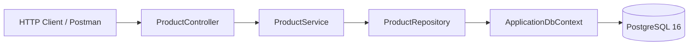

# Workshop.Api

A .NET 10 / ASP.NET Core e-commerce learning (workshop) application.

<!-- ## Status
Badges are empty — add them in Phase 0.12 (CI). For now, a .NET / PostgreSQL badge is enough.
-->

## About

This project emulates what a real-world e-commerce application looks like.
Its goal is to learn .NET and ASP.NET Core, and how to work with PostgreSQL.
For now, the project only supports fetching and creating products through the API (tested with Postman).

## Stack

| Layer | Technology |
|-------|-------------|
| Runtime | .NET 10 |
| API | ASP.NET Core (controllers) |
| ORM | EF Core 10 + Npgsql |
| Database | PostgreSQL 16 (Docker) |
| API docs | OpenAPI (built-in) |

## Architecture

## New
global.json
Solution added Domain, infrastructure, Application, API
